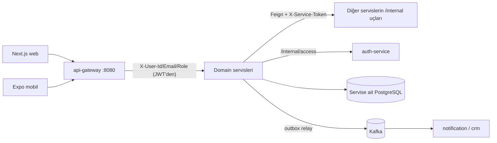

# Waylo Architecture

> Bu dosya **bugün çalışan** teknik yapıyı anlatır (son doğrulama: 23 Kasım 2026, commit `669022e` sonrası).
> Hedef ürün yönü: [PRODUCT-ARCHITECTURE.md](PRODUCT-ARCHITECTURE.md). Endpoint sözleşmeleri: [API-DOCS.md](API-DOCS.md).
> Dikey sözleşmeleri: `*-CONTRACT.md` dosyaları. Açık işler ve kararlar: `STATUS.md` (yerel, git dışı).

Waylo, işletmelerin doğrudan katıldığı çok dikeyli bir seyahat pazaryeri: otel, araç kiralama, uçuş ve otobüs.
Müşteri tek siparişte birden fazla dikeyden ürün alır, tek ödeme yapar, her kalem için QR voucher alır.
İşletmeler (kuruluşlar) partner panelinden kendi envanterini yönetir, platform admini kuruluşları ve içerikleri denetler.

## Tech Stack

| Katman | Teknoloji | Versiyon |
|---|---|---|
| Framework | Spring Boot | 4.0.8 |
| Cloud | Spring Cloud (Oakwood) | 2025.1.3 |
| JDK | Eclipse Temurin | 21 |
| Build | Gradle (Groovy DSL, multi-module) | 8.14 |
| Database | PostgreSQL (servis başına ayrı DB) | 16 |
| Migration | Flyway | (Boot managed) |
| Messaging | Apache Kafka (KRaft, Zookeeper yok) | 7.9.0 (Confluent) |
| Cache / rate limit | Redis | 7 |
| Service Discovery | Netflix Eureka (HTTP basic auth) | (Cloud managed) |
| Config | Spring Cloud Config Server, native backend (HTTP basic auth) | (Cloud managed) |
| API Gateway | Spring Cloud Gateway (WebFlux) | (Cloud managed) |
| Inter-service | OpenFeign + imzalı servis kimliği (`service-auth-common`) | (Cloud managed) |
| Web | Next.js + React | 16.4 / 19.3 |
| Mobil | Expo (React Native + TypeScript, expo-router) | SDK 58 / RN 0.88 |
| Observability | Micrometer/Prometheus, X-Request-Id, log maskeleme (`observability-common`) | - |

## Servis Listesi

| Modül | Port | Rol |
|---|---|---|
| config-service | 8888 | Config Server (native), basic auth |
| discovery-service | 8761 | Eureka Server, basic auth |
| api-gateway | 8080 | Tek public giriş: JWT doğrulama, kimlik header'larını sıfırlama, rate limit, CORS |
| auth-service | 8092 | Kimlik, JWT (access/refresh rotation), kuruluş/üyelik/kapsamlı rol, `/internal/access` yetki kararı, platform admin onayı |
| hotel-service | 8083 | Otel kataloğu, oda tipi/rate plan, günlük stok ve fiyat, quote, atomik çok geceli hold, yorumlar, RLS |
| car-rental-service | 8084 | Araç partnerleri (şirket/bireysel), şube, filo, tarife, tek yön, belge onayı, hold |
| bus-service | 8096 | Otobüs firmaları, sefer, koltuk, hold, QR biniş (satış kapısı kapalı, `BUS_SALES_ENABLED=false`) |
| flight-service | 8081 | Uçuş programları, havalimanları |
| flight-seat-inventory-service | 8082 | Koltuk envanteri, uçuş teklifleri (supplier adapter), koltuk hold |
| package-booking-service | 8085 | Order/OrderItem: tek ve çok kalemli sipariş orkestrasyonu, voucher/QR, iptal, no-show, partner sipariş görünümü, legacy `/api/bookings` (deprecated) |
| pricing-service | 8086 | Kampanya, promo kod, vergi oranı, fiyat önizleme, sipariş için fiyat rezervasyonu |
| payment-service | 8087 | Payment intent, escrow, append-only ledger, komisyon, iade, tedarikçi bakiyesi. Provider: `TEST` (iyzico anahtar bekliyor) |
| crm-service | 8088 | Müşteri profili (id = auth userId, auth-events ile senkron), sadakat mekanizması kapalı |
| checkin-service | 8089 | Order uçuş kalemleri için online check-in |
| notification-service | 8090 | E-posta ve Expo push, gerçek teslim durumu (SENT/SUPPRESSED/FAILED/GAVE_UP), otomatik yeniden deneme, cihaz kaydı |
| traffic-simulator | 8095 | Admin-only, sınırlı salt-okuma yük testi |
| package-booking-saga-orchestrator | 8091 | **Emekli.** Compose profili `legacy-saga`, varsayılan olarak başlamaz (bkz. Karar 6) |
| observability-common | - | Kütüphane: request id, metrikler, outbox backlog gauge, log varsayılanları |
| service-auth-common | - | Kütüphane: imzalı servis kimliği (filter + Feign interceptor) |
| frontend (Next.js) | 3000 | Müşteri, partner (`/partner/*`) ve admin (`/admin/*`) yüzeyleri, ayrı layout ve guard |
| mobile (Expo) | - | Müşteri uygulaması: arama, sepet, checkout, QR siparişler, yorum, check-in, push |

Domain servis portları host'ta yalnız `127.0.0.1`'e bağlıdır. Dışarıya açık olanlar gateway (8080) ve frontend (3000).
flight-service ve crm-service host'ta 18081/18088'e eşlenir (konteyner içi 8081/8088).

## İstek ve güven akışı



1. **Gateway**: `typ=access` ve issuer `waylo-auth` olan JWT'yi doğrular, refresh token'ı reddeder. İstemciden gelen
   `X-User-Id`, `X-User-Email`, `X-User-Role`, `X-Internal-Token`, `X-Service-Token` header'larını her istekte siler ve
   kimliği yalnız doğrulanmış token'dan yazar. Katalog GET'leri public, geri kalan her şey token ister. `/internal/**` route'u yoktur.
2. **Yetki domain serviste**: gateway yalnız kimliği doğrular. Kuruluş/tesis kapsamlı yetki her serviste
   `auth-service /internal/access` ile kontrol edilir ve hata durumunda **fail-closed** davranır.
   Client'ın gönderdiği `organizationId` yalnız seçicidir, yetki kanıtı değildir.
3. **Servisler arası kimlik** (`service-auth-common`): çağıran servis kendi Ed25519 anahtarıyla kısa ömürlü bir JWT imzalar
   (`iss`=çağıran, `aud`=hedef, `exp-iat` <= 60 sn, `jti`). Token tek kullanımlıktır: alıcı servis kabul ettiği `(iss, jti)`
   çiftini süre dolana kadar hatırlar, tekrar gelen token 401 alır (servis örneği başına bellek içi). Hedef servis her `/internal` route grubu için izinli çağıranları
   `waylo.service-auth.routes` altında tanımlar. Tanımsız `/internal` yolları fail-closed'dır.
   Eski paylaşımlı `INTERNAL_API_TOKEN` / `X-Internal-Token` kaldırıldı, yalnız imzalı token kabul edilir.
   Anahtarlar `scripts/gen-service-keys.py` ile `.env`'e yazılır.

## Mimari Kararlar

### 1. DB-per-Service
Her servis kendi PostgreSQL veritabanına sahiptir. Cross-DB foreign key veya başka servisin DB'sine SQL erişimi yoktur.
Referanslar UUID, servis sözleşmesi (Feign `/internal`) ve Kafka olaylarıyla taşınır.

### 2. Kafka: KRaft Mode
Tek konteyner, Zookeeper yok. Topic'ler: `auth-events`, `order-events`, `payment-events`, `flight-events` ve legacy
`/api/bookings` akışının `booking-events` topic'i.

### 3. Config Server: Native Backend
Dosya sistemi backend'i. Eureka ve config-service HTTP basic auth ile korunur. Compose'daki dev şifre varsayılanları
paylaşımlı ortamlarda `.env` ile ezilmelidir.

### 4. Apache Ignite ve 5. Akka: kullanılmıyor
Redis cache/rate-limit ihtiyacını karşılıyor. Spring request/response modeli ve Java 21 virtual thread'leri yeterli.
İki ayrı concurrency modeli bakım ve debug maliyeti getirir.

### 6. Sipariş orkestrasyonu: package-booking-service içinde senkron (saga emekli)
Başlangıçta Kafka tabanlı bir saga orchestrator vardı. Bugün sipariş akışını `OrderServiceImpl` yürütür:
1. Fiyat: otel için hotel-service quote'u, diğer dikeylerde dikey servisin teklifi. pricing-service kampanya/promo/vergiyi uygular ve sipariş için rezerve eder.
2. Her kalem için dikey servisten **hold** alınır (otel: tüm geceler tek transaction'da, `PESSIMISTIC_WRITE` kilidi
   `roomTypeId, stayDate` sırasıyla alınır).
3. Bir adım başarısız olursa alınmış hold'lar ve fiyat rezervasyonu **ters yönde serbest bırakılır**. Serbest bırakma
   başarısız olursa her dikeyin expiry scheduler'ı hold'u süre dolunca geri alır.
4. Tek ödeme: payment-service intent ve escrow oluşturur. Ödeme sonucu `markPaid` ile siparişe döner.
5. `markPaid` her kalemin hold'unu idempotent olarak **confirm** eder. Confirm edilemeyen kalem iade edilir ve hold'u bırakılır.
   Teyit edilen kalemler için QR voucher üretilir.

Saga yalnız legacy `PackageBooking` adımlarını işaretliyordu, gerçek rezervasyon yapmıyordu. Bu yüzden ikinci ve yanıltıcı bir
doğruluk kaynağı olmaması için devreden çıkarıldı (`SAGA-DECISION.md`). Modül derlenir ve testleri çalışır, `/api/sagas` route'u 503 döner.

**Zaman aşımı ve uzlaştırma (RM-27):** `PendingOrderExpiryJob` (60 sn) hold süresi + 2 dk geçmiş PENDING siparişleri
`EXPIRED` yapar, kalan hold'ları ve fiyat rezervasyonunu bırakır, `ORDER_EXPIRED` olayı yazar. EXPIRED siparişe geç gelen
`markPaid` 409 `ORDER_EXPIRED` alır ve payment-service provider ödemesini iptal eder: geç ödeme süresi dolmuş hold'u asla
kendiliğinden onaylamaz. payment-service'teki `PaymentReconciliationJob` (60 sn) 5 dakikadan eski, escrow'u olmayan AUTHORIZED
intent'leri siparişe sorar: sipariş CONFIRMED ise escrow ve ledger confirm ile aynı kod yolundan (`holdInEscrow`) idempotent
olarak yeniden kurulur; sipariş ödenmemişse provider ödemesi iptal edilir; diğer durumlar `MANUAL_REVIEW` olarak bekler.
Her karar append-only `payment_reconciliations` tablosuna yazılır, admin `GET /api/admin/payment-reconciliation` ile görür.

### 7. İptal, iade ve finans
İptal kuralları kalem bazında saklanan **politika snapshot'ından** hesaplanır, sonradan fiyat veya otel düzenlemesi bunu değiştirmez.
`GET /api/orders/{id}/cancellation-preview` sonucu önceden gösterir. Para iadesi, escrow ve stok serbest bırakma ayrı sonuçlarla izlenir.
Komisyon, işletme alacağı ve iade etkisi payment-service'te **append-only ledger** kayıtlarıdır. Partner kazanç ekranı
escrow kalemlerinden beslenir, para birimi başına toplamlarla.

**Partner payout** (`PAYOUT-CONTRACT.md`): ödenebilir bakiye saklanmaz, her seferinde hesaplanır:
RELEASED escrow'un komisyon düşülmüş tutarı (holdback süresi geçmiş) + payout ledger delta'ları. HELD escrow sadece tahmin olarak
gösterilir. Akış `REQUESTED -> APPROVED -> PROCESSING -> PAID / FAILED`, `CANCELLED`; talepte para ayrılır, başarısız
veya iptal edilen talepte geri döner. Çift ödemeye karşı kuruluş+para birimi başına kilit satırı, açık talep tekilliği,
idempotency key ve benzersiz banka referansı vardır. Para hareketi Waylo içinde yapılmaz: admin havaleyi yapıp referansı
kaydeder. IBAN AES-GCM ile şifreli saklanır (`WAYLO_PAYOUT_IBAN_KEY`), her yerde maskelenir, tam hali yalnız
denetim kaydı bırakan admin uç noktasından görülür. Merchant-of-record kararı açıktır.

### 8. Olaylar: transactional outbox + idempotent consumer
auth-service, package-booking-service ve payment-service domain değişikliğini ve olayı aynı local transaction'da
`outbox_event` tablosuna yazar. `OutboxRelay` olayları Kafka'ya taşır, backlog metrik olarak izlenir.
Consumer tarafında `processed_events` tablosu tekrar işlemeyi engeller ve yalnız başarılı işlemden sonra yazılır.
Kafka exactly-once iş etkisi garantisi olarak sunulmaz. `X-Request-Id` HTTP ve Kafka üzerinden uçtan uca taşınır.

**Dead-letter** (`observability-common/dlt`): crm, notification ve flight-seat-inventory consumer'ları hatayı yutmaz.
`DefaultErrorHandler` 3 kez dener (1s/2s/4s), sonra kaydı orijinal key, value ve header'larıyla `<topic>.DLT`'ye yazar.
Offset yalnız DLT yazımı başarılı olunca commit edilir. Deserialization ve doğrulama hataları denenmeden DLT'ye gider.
Admin `GET /api/admin/kafka-dlt` ile bakar (maskeli, kısaltılmış), `POST /api/admin/kafka-dlt/replay` ile tek kaydı
orijinal topic'e geri yollar; idempotent consumer tekrar işlemeyi önler. Sayaç: `waylo.kafka.dlt.published`.

**Bildirim teslimi (RM-30):** FAILED e-posta/push bildirimleri `DeliveryRetryJob` ile 1 dk, 5 dk, 30 dk, 2 sa ve 12 sa sonra
aynı gönderim yolundan yeniden denenir (satırlar `FOR UPDATE SKIP LOCKED` ile alınır, iki instance aynı satırı göndermez).
5 denemeden sonra durum `GAVE_UP` olur. SENT ve SUPPRESSED asla yeniden gönderilmez. Sayaç: `waylo.notifications.delivery`.

### 9. Kiracı izolasyonu: kod + PostgreSQL RLS (hotel, car-rental, bus, package-booking)
Kod katmanı: her mutasyon `HotelAccessGuard` ile auth-service'e sorulur, child kayıtlar `hotelId + childId` ile bağlanır.
DB katmanı (V9): uygulama her transaction'da `SET LOCAL ROLE waylo_app` (NOLOGIN, BYPASSRLS yok) ve transaction-local
`app.mode` / `app.org_ids` ayarlar. Partner modunda yalnız yetkili kuruluşların satırları okunur ve yazılır. Public, servis ve admin
okumaları bugünkü gibi kalır. Mod başlangıçta en düşük yetkidir (`/internal` ve `/internal/...` -> SERVICE, ADMIN rolü -> ADMIN,
geri kalan -> PUBLIC). PARTNER modu yalnız başarılı erişim kontrolünden sonra açılır. Bağlam transaction sonunda düşer, pool'da sızmaz.
Aynı model car-rental-service (şube, araç, tarife, tek yön, belge) ve bus-service (otobüs, sefer, durak, ücret, belge) için de
kuruludur. Rezervasyon, hold, quote ve outbox gibi işlem tabloları kapsam dışıdır. package-booking'de (V12) `order_items`
(`supplier_organization_id`) ve `vouchers` partner modunda RLS altındadır; `orders` kodda müşteri sahipliğiyle korunur, job'lar
SERVICE modunda çalışır. Tüm dikeylerin yetki matrisi ve RLS sınıflandırması `scripts/acceptance/tenant_matrix.py` ile sınanır (RM-37).

### 10. Otel yayın akışı, public projeksiyon ve satış kapısı
Otel `DRAFT -> SUBMITTED -> APPROVED -> PUBLISHED` akışından geçer (`REJECTED`, `SUSPENDED`, `ARCHIVED` de var,
`HOTEL-PUBLICATION-CONTRACT.md`). Kayıt olmak satışa açılmak değildir: partner yayın talebi gönderir (kuruluş ACTIVE olmalı,
en az bir oda tipi, rate plan ve stok gerekir), platform admini onaylar veya gerekçeyle reddeder; kendi kuruluşunun otelini
onaylayamaz. Yayındaki otelin içerik değişikliği revizyon olarak bekler, onaylanmadan yayına çıkmaz. Her geçiş append-only
karar kaydı bırakır.

Public liste, arama, detay, müsaitlik, anonim alt kayıt okumaları ve yeni quote/hold yalnız PUBLISHED, aktif ve `ACTIVE`
kuruluşa ait oteller içindir; diğerleri public için 404, quote için 422 `HOTEL_NOT_BOOKABLE`. Mevcut hold'ların
confirm/release'i yayın durumuna bakmaz. Kuruluş durumu auth-service'ten 30 sn cache'lenir; auth-service erişilemezse
kuruluş otelleri gizlenir (fail-closed). V10 öncesindeki bütün oteller PUBLISHED olarak devralındı. Kuruluşu olmayan
22 legacy otel salt-okunur görünür (sahiplik kararı kullanıcıda). Bus satışları hukuki maddeler kapanana kadar kapalıdır.

**Konaklama tamamlama (RM-29):** QR okutma check-in sayılır ve escrow'u serbest bırakır. Partner check-out'u ayrıca kaydeder
(`.../order-items/{id}/check-out`). Yorum hakkı yalnız kayıtlı check-out'tan sonra doğar; tarih geçmesi yetmez, NO_SHOW ve
iptal hak vermez.

**Otel fotoğrafları (sözleşme bölüm 5):** partner JPEG/PNG/WebP yükler (magic byte ile tespit, 5 MB, en az 800x600, otel başına 20).
EXIF/XMP/IPTC silinir, dosya rastgele anahtarla `hotel_media` volume'ünde saklanır, kullanıcının dosya adı kullanılmaz.
Harici virüs tarayıcı yoktur: yapısal çözümleme tarama yerine geçer, fotoğraf admin onayına kadar görünmez. Public servis yalnız
onaylı fotoğrafları ve yalnız public otel için verir (aksi 404). `hotel_media` RLS altındadır; partner kendi fotoğrafını
onaylayamaz (trigger). Silme soft delete'tir (V12 `deleted_at`): append-only karar kayıtları fotoğrafa bağlı kalır, dosya
volume'den silinir, silinmiş satır hiçbir okumada görünmez ve partner geri alamaz.

### 11. Spring Boot 4.x artifact değişiklikleri
- `spring-boot-starter-web` -> `spring-boot-starter-webmvc`
- `spring-boot-starter-kafka` (eski `spring-kafka` yerine)
- `spring-boot-starter-flyway` + `flyway-database-postgresql`
- `spring-cloud-starter-gateway` -> `spring-cloud-starter-gateway-server-webflux`
- Jackson 3 varsayılan JSON kütüphanesi.

## Çalıştırma

Dizüstü bilgisayarda bütün yığını aynı anda çalıştırmak ağırdır. İşe göre küçük setler kullanılır:

```bash
scripts/dev-up.sh hotel     # core + hotel + orders + payments (car | bus | flight | mail | all | down)
```

Core: postgres, kafka, redis, config, discovery, gateway, auth, frontend. Her Java servisi `-Xmx256m` ve 384 MB bellek
limitiyle çalışır. Tek servis yeniden dağıtımı: `docker compose up --no-deps -d --build <servis>`.
Başlangıç sırası compose `depends_on` ve healthcheck ile sağlanır: config -> discovery -> gateway/auth -> domain servisleri.

**Production:** `docker compose -f docker-compose.yml -f docker-compose.prod.yml up -d`. Overlay tüm sırları zorunlu yapar
(dev varsayılanları yok) ve `prod` profilini açar; `ProductionSecretsGuard` bu profilde boş, dev literal'i veya 32 karakterden
kısa sırla başlamayı reddeder (mesajda yalnız değişken adı geçer). Statik kontrol: `scripts/check-prod-config.sh`.
`WAYLO_PAYOUT_IBAN_KEY` ilk kullanımdan sonra asla değiştirilmez.

## Test ve kalite kapıları

- Unit: `./gradlew :<modül>:test` (hotel-service RLS için Testcontainers PostgreSQL kullanır).
- Statik: `python3 scripts/check-bean-constructors.py` (Spring bean'lerinde tek constructor) ve `scripts/check-yaml-duplicates.py`.
- Canlı kabul: `scripts/test-*.py` gateway üzerinden gerçek akışları sınar. Örnekler: test-package-order, test-payments,
  test-rls, test-service-auth, test-gateway-security. Kiracı yetki matrisi (RM-37): `scripts/acceptance/tenant_matrix.py`
  (sahip/müdür/personel/diğer kuruluş/müşteri/admin x uç noktalar, sıfır DB etkisi ve RLS sınıflandırması, JSON kanıt raporu).
- Web: `npx tsc --noEmit`, `npx eslint`, `npm test`, Playwright e2e (`frontend/e2e`).
- Mobil: `npx tsc --noEmit`, `npx jest --ci`, `npx expo lint`.
- CI (`.github/workflows/ci.yml`): statik kontroller + tüm Gradle testleri, frontend ve mobil kontrolleri.

## Klasör Yapısı (Domain Servisleri)

```
src/main/java/com/waylo/{servisadi}/
├── controller/      # REST endpoints (public /api/** ve servisler arası /internal/**)
├── service/         # İş mantığı
├── repository/      # JPA
├── domain/          # Entity ve enum'lar
├── dto/             # Request/response record'ları, MapStruct mapper
├── client/          # Feign client'ları
├── security|filter/ # Erişim kontrolleri
├── config/          # Spring konfigürasyonu
├── event/           # Kafka producer/consumer, outbox
└── exception/       # Hata tipleri ve global handler
```
