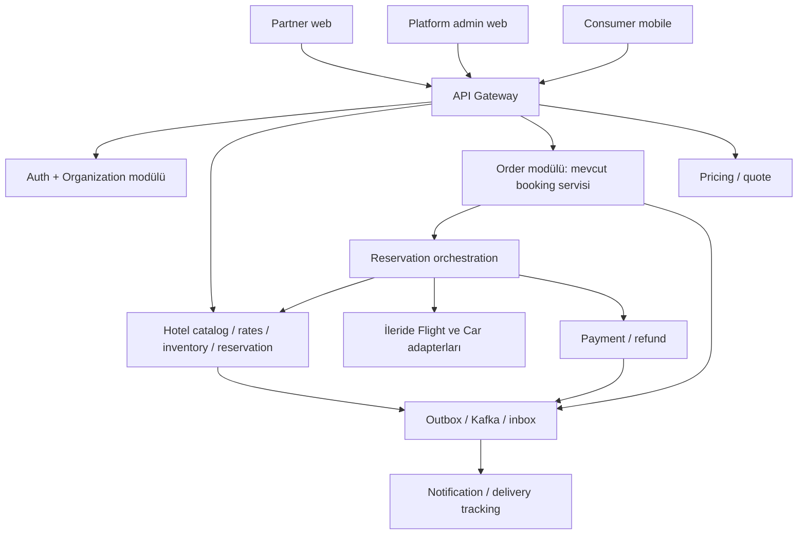

# Waylo ürün mimarisi: otel B2B → tüketici mobil → çok dikeyli seyahat

Tarih: 14 Ekim 2026. Durum: tasarım önerisi, uygulandı veya kullanıcı tarafından nihai onaylandı değildir.
Bu doküman yeni ürün yönünü tanımlar. Mevcut runtime için `ARCHITECTURE.md` geçerlidir.
Hedef temeli değiştirme riskini azaltmaktır, gelecekte hiç migration veya refactor gerekmeyeceği garantisi değildir.

## 1. Ürün kararı ve kapsam

Waylo, yalnız dış tedarikçi kataloğunu gösteren bir uygulama değil, işletmelerin doğrudan katılabildiği bir seyahat pazaryeri olacak.
İlk dikey otel. İlk teslim işletme web paneli ve backend, ardından son kullanıcı mobil uygulaması.
Otel işletmesi kuruluş açar, tesislerini ekler, içerik, oda tipleri, tarihli stok/fiyat ve rezervasyonlarını yönetir.
Müşteri yayınlanmış tesisleri arar, rezervasyon yapar, tamamlanmış konaklaması için değerlendirme bırakır.
Platform işletmeyi ve yayını denetler. Kayıt olmak otomatik olarak satışa açılmak değildir.
Doğrudan otel arzı birinci aşamanın kaynağıdır. Dış yatak bankası/PMS/channel-manager ayrı adapter yoludur.

### Teslim ilkeleri

- MVP özellik sayısını azaltır, kiracı izolasyonunu, sahiplik kontrollerini ve işlem tutarlılığını azaltmaz.
- Ortak çekirdek: kimlik, kuruluş/üyelik, erişim politikası, para birimi, sipariş, ödeme, bildirim, audit.
- Dikeyler ayrı: otel gecelik stok, uçuş segment/koltuk/ticketing, araç süre/şube/filo.
- Ortak arayüz yalnız gerçekten ortak davranışı paylaşır. Her dikeyi bir `GenericProduct` tablosuna sıkıştırmayız.
- Mevcut Spring/Next.js altyapısı korunur. Yeni iş sınırı her zaman yeni deploy edilen mikroservis demek değildir.
- Test sadece mobil bittikten sonra yapılmaz. Her aşama kendi test kapısından geçer, sonunda tam akış yeniden çalışır.
- Mevcut 83 ayrıntılı görev uygulama backlog'udur. Yeni tasarımla eşleştirilmeden hepsi MVP kapsamına taşınmaz.

## 2. Mevcut kodla farklar

| Kanıt dosyası | Bugünkü model | Hedefte gereken değişiklik |
|---|---|---|
| `auth-service/.../domain/UserRole.java` | USER, ADMIN | Platform rolleri ve kuruluş/tesis kapsamlı üyelikler ayrılmalı |
| `auth-service/.../domain/User.java` | Kullanıcıda tek role alanı | Aynı kişi müşteri ve birden fazla işletmenin üyesi olabilmeli |
| `auth-service/.../config/JwtUtil.java` | Tek role claim, access/refresh aynı issuer akışı | Token türü, audience, oturum ve güncel üyelik doğrulaması |
| `hotel-service/.../domain/Hotel.java` | tenant yok, active boolean | Kuruluş sahipliği, yayın durumu, onay ve içerik revision'ı |
| `hotel-service/.../domain/Room.java` | Fiziksel oda, statik fiyat ve AVAILABLE | Oda tipi, gecelik stok, rate plan ve tarihli satış kısıtları |
| `hotel-service/.../controller/HotelController.java` | Ortak CRUD `/api/hotels` | Yönetim ve yayınlanmış müşteri projeksiyonları ayrılmalı |
| `hotel-service/src/main/resources/db/migration/V1__init.sql` | Otel silmede odalar cascade | Rezervasyon geçmişini koruyan arşivleme ve kontrollü geçiş |
| `package-booking-service/.../domain/PackageBooking.java` | Tek flight/hotel/vehicle referansı | Sipariş ve çok satırlı, dikeye özgü booking item |
| `frontend/src/app/*/page.tsx` | Genel operasyon ekranları | Partner, platform yönetimi ve müşteri yüzeylerinin ayrılması |

`...` Java package yolunun kısaltmasıdır. Bunlar kod okuma bulgularıdır, güvenlik testi sonucu değildir.

## 3. Kimlik, kuruluş ve tesis kapsamı

### Temel varlıklar

- `User`: tek kimlik. Müşteri hesabı ayrı bir giriş kimliği gerektirmez.
- `Organization`: ticari işletme ve tenant sınırı. Bir kuruluş birçok otel veya araç şubesi yönetebilir.
- `OrganizationMembership(userId, organizationId, status, permissionVersion)`.
- `RoleAssignment(membershipId, role, scopeType, scopeId)`: kuruluş veya belirli tesis kapsamı.
- `Hotel(organizationId, timezone, publicationStatus, sourceType)`.
- `OrganizationApplication`: başvuru, denetim kararı ve gerekçe. İşletme onayı otel yayın onayından ayrıdır.
- `AuditEntry(actor, organizationId?, resource, action, before/after reference, reason, timestamp)`.

Organizasyon tenant'ı bir otel ID'siyle aynı değildir. Zincir, bir tenant altında birden fazla tesis yönetebilir.
Organizasyonlar auth içinde ayrı bir partner modülüyle başlar. Sonradan partner-service'e ayrılabilecek API sınırı korunur.
Başka servisler auth DB'sine SQL veya cross-DB foreign key ile erişmez. Referans UUID, servis sözleşmesi ve olaylarla taşınır.

### Rol matrisi

| Rol | Kapsam | Yetki |
|---|---|---|
| CUSTOMER | Kendi kimliği | Kendi rezervasyonu/profili, uygun konaklaması için yorum |
| HOTEL_OWNER | Kuruluş + atanmış oteller | Tesis yönetimi, ekip/rol atama, ticari özet. Platform onayı veremez |
| HOTEL_MANAGER | Atanmış oteller | İçerik, stok, fiyat, rezervasyon operasyonu. Owner devri yapamaz |
| HOTEL_STAFF | Atanmış oteller | Tanımlı operasyon izinleri. Varsayılan fiyat/ekip/finans yetkisi yok |
| ORGANIZATION_OWNER | Kuruluş | Kuruluşun sahipliği ve üyelikleri. Dikey yetkisi ayrıca atanır |
| PLATFORM_ADMIN | Platform | Başvuru ve yayın incelemesi, denetimli müdahale |
| PLATFORM_SUPPORT | Açık vaka kapsamı | Sınırlı müşteri/rezervasyon destek erişimi, genel süper yetki yok |

Rol tek başına yeterli değildir. Karar = kimlik + aktif üyelik + permission + tesis kapsamı + kaynak sahipliği + durum.
`hotel_owner` açık kayıt formundan atanamaz. Başvuru sahibi yalnız kendi taslağını yönetebilir, onay sonrası satış yetkisi açılır.
Aynı kullanıcı bir kuruluşta owner, başka kuruluşta staff ve aynı zamanda müşteri olabilir.
Owner devri yeniden kimlik doğrulama ve audit ister. Son owner'ın kaldırılması reddedilir.
Kuruluş üyeliği ve ORGANIZATION_OWNER ataması yalnız kuruluş owner'ına aittir. HOTEL_OWNER yalnız kendisine atanmış tesislerde manager/staff atayabilir, kuruluş owner'ı veya kendi scope'undan geniş owner yetkisi veremez.
Her delegasyon aktörün mevcut grantable permission ve tesis kümesinin alt kümesi olmalıdır. Rol güncellemesi/davet kabulünde bu sınır yeniden doğrulanır.
İlk sürüm hazır rol paketleri kullanır, kullanıcı tanımlı keyfi permission editörü kapsam dışıdır.

### İzolasyon kuralları

1. İstemcinin gönderdiği organizationId/tenant header yalnız seçicidir, yetki kanıtı değildir.
2. Her serviste resource-level yetki denetimi yapılır. Gateway ve UI gizleme tek savunma değildir.
3. Lookup `organizationId + hotelId + childId` ile bağlanır. Başka otele ait childId kullanılamaz.
4. Üyelik iptalinde kritik mutasyon güncel otoriteden doğrulanır, yetki servisi erişilemezse fail-closed.
5. Access token kısa ömürlü ve tür/audience doğrulamalı, refresh token access yerine kabul edilmez. Refresh rotation/oturum iptali planlanır.
6. Tenant-owned tablolarda organizationId zorunlu, tenant-aware unique/FK/indeksler kullanılır.
7. DB-per-service korunur. Tenant-owned tablolarda scoped repository ve PostgreSQL RLS savunma katmanı hedeflenir.
8. RLS request bağlantısı superuser/BYPASSRLS olmamalı. Tenant bağlamı transaction-local kurulmalı ve pool tekrar kullanımında test edilmelidir.
9. Her tablo tenant-owned, user-owned, platform-global veya public projection olarak sınıflandırılır. Public arama için yapay tek tenant atanmaz.
10. Public projection yalnız yayınlanmış, güvenli alanları içerir. İşletme belgeleri, misafir kimliği, ticari hesaplar halka açılmaz.
11. Korunan cache, dosya, export ve async işlerde kapsam taşınır. İmzalı dosya URL'si üretilmeden exact-object yetkisi kontrol edilir.
12. Platform çapında iş ve siparişler açık cross-tenant yetkiyle çalışır, tenant filtresini sessizce atlamaz.
13. Destek erişimi gerekçe, süre, maskeleme ve audit ile sınırlandırılır. Tenant offboarding mevcut rezervasyonları silmez.
14. Domain servisleri public internete açılmaz. Network izolasyonuna ek olarak doğrudan servis API'sinde principal ve service identity kontrolü yapılır, forged gateway header kabul edilmez.

Bu politika OWASP Multi-Tenant Security rehberiyle uyumlu tasarım hedefidir, henüz uygulanmış kontrol değildir.

## 4. Otel bounded context

### İçerik ve yayın

`DRAFT → SUBMITTED → APPROVED → PUBLISHED`, ayrıca `REJECTED`, `SUSPENDED`, `ARCHIVED`.
Başvuru/inceleme/karar birer kayıtlı işlem olur. Kritik değişiklikler yeni content revision ve inceleme gerektirir.
Yayınlanmış revision müşteri yüzeyinde kalabilir, taslak değişiklikler otomatik yayınlanmaz.
Müsaitlik/fiyat güncellemesi içerik revision'ından ayrıdır. Askıya alınmış otel yeni satış yapamaz, mevcut rezervasyon desteği sürer.
Fotoğraflar hak kaynağı, sıralama ve erişim kapsamıyla saklanır. Upload boyutu/türü doğrulanır, tarama tamamlanmadan yayınlanmaz.
Otel yıldızı ile müşteri puanı farklı alanlardır. Doğrulanmamış yıldız resmî sınıflandırma gibi sunulmaz.

### Konaklama satış modeli

- `RoomType`: işletmeye özgü oda tipi, kapasite, kişi/çocuk kuralları, özellikler.
- `PhysicalRoom`: opsiyonel gerçek oda numarası/operasyon durumu. Satış sırasında belirli oda atanması şart değildir.
- `RatePlan`: yemek, iptal, ödeme ve satış koşulları.
- `DailyInventory(hotelId, roomTypeId, stayDate, allotment, outOfService, held, confirmed, version)`.
  `available = allotment - outOfService - held - confirmed >= 0`. allotment toplam Waylo kapasitesidir, outOfService bunun içinden düşer. Aynı kapasite ikinci kez düşülmez.
- `DailyRate(roomTypeId, ratePlanId, stayDate, occupancyBand, amount, currency, taxPolicyVersion)`.
- `SalesRestriction`: stop-sell, min/max stay, closed-to-arrival/departure ve booking-window.
- `HotelHold`: tüm geceleri atomik tutar, expiresAt içerir. Confirm/release idempotenttir.
- `HotelReservation`: müşteri, tarih, guest summary, hold reference ve değişmez ticari snapshot.
- `InventoryAdjustment`: aktör, neden, eski/yeni kapasite. `allotment - outOfService` held+confirmed altına indirilemez.

Konaklama tarihleri tesis saat diliminde yerel tarih, aralık `[checkIn, checkOut)` olur. Checkout gecesi satılmaz.
Fiyat `starRating` veya rastgele katsayıdan türetilmez. Eksik fiyat/müsaitlik bilinmiyor olarak gösterilir, rezervasyona izin verilmez.
Inventory rate plan başına çoğaltılmaz. Bir oda tipinin ortak stoku bütün rate plan satışlarında aynı kaynaktır.
Birden fazla gecenin kapasitesi tek transaction'da ve kararlı lock sırasıyla korunur. Bir gece yetersizse hiçbir gece tutulmaz.
Son oda için eşzamanlı iki hold'dan biri kazanır. Cache son stok otoritesi değildir.
Expired hold'a geç ödeme gelirse otomatik teyit yapılmaz, tekrar stok edinme veya refund/manual-review yolu çalışır.
Satış modeli ilk sürümde doğrulanmış stokla instant confirmation. Manual-request modu daha sonra ayrı durum/UX ile eklenebilir.
İşletme panelindeki statü dropdown'u keyfi booking state değiştiremez, yalnız izinli command'lar vardır.

### Harici kanal sınırı

İlk aşama Waylo'ya ayrılmış allotment ile çalışır. İşletmenin başka kanallardaki satışlarını bilmeden toplam tesis overbooking'ini önlediğimizi iddia etmeyiz.
İşletme anlaşması, stok güncelleme sorumluluğu ve kontrol pilotun yayın kapısıdır.
PMS/channel-manager daha sonra authoritative inventory adapter olur. `sourceType=DIRECT|EXTERNAL` ile ownership belirlenir.
External rate/booking, supplier sözleşmesinin izin verdiği alanlardan yönetilir. External otel kaydı otomatik işletme owner'ına teslim edilmez.

## 5. Sipariş, fiyat, ödeme ve finans sınırları

- `Order(customerId, status, currency, quoteId)` müşterinin ticari işlemi.
- `OrderItem(vertical, supplierOrganizationId, productRef, fulfillmentRef, commercialSnapshot)`.
- `HotelReservation`, `FlightBooking`, `CarReservation` kendi dikeyinin fulfillment modelidir.
- İleride bir Order birçok kuruluş ve dikeyden item içerebilir. Sipariş bütünü tek otelin tenant malı değildir.
- Otel paneli yalnız kendi item/misafir projeksiyonunu görür. Müşterinin diğer oteli, uçuşu ve ödemesinin tamamını göremez.
- Order toplamı ve müşteri payment detayları yalnız sipariş sahibine veya açık platform finans/destek politikasına açıktır. Partner'e kendi item tutarı, kendi alacağı ve operasyon için minimum misafir verisi verilir.
- İlk sürüm bir order/bir otel item kullanır. Model birden çok item'e hazır, paket UI ve karmaşık partial fulfillment şimdi yapılmaz.
- pricing-service quote oluşturur. Otel domain'i tarih/occupancy fiyat ve koşullarının otoritesidir. Quote, vergi/ücret/indirim/komisyon snapshot'ını dondurur.
- Quote sunucu tarafında tekrar doğrulanır. Para `amount + currency`, decimal/minor-unit sözleşmesiyle tutulur, float kullanılmaz.
- Bir order tek settlement currency kullanır. Çok para birimli paket satışı kur ve muhasebe politikası belirlenmeden açılmaz.
- payment-service ödeme attempt, imzalı callback, idempotency ve refund sahibi. Kart bilgisi uygulamada saklanmaz.
- `PaymentStatus`, `OrderStatus`, `FulfillmentStatus` ayrı state machine'lerdir. Payment success tek başına otel confirmation değildir.
- İlk akış: quote → atomik hold → order/payment attempt → doğrulanmış ödeme sonucu → hold confirm → rezervasyon teyidi.
- Confirm başarısızlığında stok ve tahsilat reconciliation yapılır. Kullanıcıya belirsiz sonucu success olarak göstermeyiz.
- Refund async olabilir. İptal, finansal iade ve stok release ayrı sonuçlarıyla izlenir.
- Cancel policy snapshot'ı sonradan fiyat/otel düzenlemesiyle değişmez. Para iadesi yalnız policy ve ödeme sonucuna göre hesaplanır.
- Komisyon, işletme alacağı ve refund etkisi append-only ledger kayıtlarında modellenir. Dashboard tahmini gelir ile gerçekleşmiş tahsilatı ayırır.
- Merchant-of-record, ödeme alma yetkisi, sözleşme, komisyon ve payout sorumluluğu açık işletme kararıdır. Bu doküman hukuki onay değildir.
- Sandbox ödeme ilk teknik test için yeterlidir, gerçek tahsilat ve işletmeye ödeme kapısı ayrıca doğrulanır.

Local DB transaction + outbox ile domain mutation ve event atomik kaydedilir. Consumer inbox/dedup ve retry kullanır.
Kafka exactly-once iş etkisi garantisi olarak sunulmaz. Event `eventId, version, occurredAt, correlationId, causationId, producer, scope` taşır.
Tenant işleri server-verified organization scope ile, cross-tenant order işleri açık platform scope ile yürür. Broker ACL ve servis kimliği doğrulanır.
Idempotency `(principal/scope, operation, key)` bazlıdır. Aynı key farklı body ile 409 verir.

## 6. Yorum ve güven sistemi

`Review(hotelReservationId, customerId, hotelId, score, text, moderationStatus)`.
İlk ürün kararı: rezervasyonu yapan kullanıcı başına konaklama başına bir yorum, puan 1..5.
Yorum için reservation `COMPLETED` olmalı, checkout geçmiş olmalı, kullanıcı rezervasyon sahibi olmalı.
COMPLETED yalnız tarih geçmesiyle oluşmaz, kayıtlı check-out operasyonuyla oluşur. NO_SHOW ayrı terminal durumdur, COMPLETED değildir.
İptal, no-show ve ödeme denemesi yorum hakkı vermez. Kendi tesisinde aktif işletme üyeliği olan müşteri yorum veremez.
İşletme yalnız yanıt bırakabilir ve şikâyet edebilir, müşterinin puanını değiştiremez/silemez.
Moderasyon bağımsızdır, kaldırma neden/audit ister. Skor ortalaması yalnız yayınlanmış uygun review'lardan hesaplanır.
Yorumsuz otelde puan null ve reviewCount=0, sahte varsayılan yüksek puan yoktur.
Düzenleme, itiraz ve moderasyon geçmişi korunur. Review edit penceresi gibi ticari kurallar pilot öncesi belirlenir.

## 7. UI yüzeyleri ve API sınırları

### Web yüzeyleri

- `/partner/onboarding`: kuruluş başvurusu, denetim durumu.
- `/partner/hotels`: kuruluş/tesis seçimi, taslak/yayın durumları.
- `/partner/hotels/{hotelId}/content`: içerik, konum, fotoğraf, özellik, yayın talebi.
- `/partner/hotels/{hotelId}/room-types`: oda tipleri ve rate planlar.
- `/partner/hotels/{hotelId}/calendar`: tarihli stok, fiyat ve stop-sell.
- `/partner/hotels/{hotelId}/reservations`: scoped liste/detay, check-in/out/no-show, policy-bound cancellation.
- `/partner/hotels/{hotelId}/reviews`: gerçek yorum ve işletme yanıtı.
- `/partner/team`: davet, tesis scope'u, rol, iptal.
- `/partner/finance`: kendi item'larına ait gerçekleşmiş finans verisi. Payout entegrasyonu hazır değilse açık durum.
- `/admin/organizations`, `/admin/hotel-publications`, `/admin/moderation`, `/admin/audit`: ayrı platform paneli.
- Müşteri mobil: arama, detay, quote/checkout, rezervasyonlar, yorum, profil. İşletme yetkisi consumer ekranında kullanılmaz.

İlk web Next.js projesinde route/layout izolasyonu ile başlar. Ayrı deploy/domain sonradan sözleşmeleri değiştirmeden yapılabilir.
Ayrı dashboard ayrı güvenlik politikası demektir, yalnız sidebar değişikliği değildir.
Mobil API backend'e dayanır. Flutter/React Native seçimi bu mimarinin ön şartı değildir.

### Önerilen endpoint ve method listesi

Aşağıdakiler **yeni önerilerdir**, bugün çalıştıkları iddia edilmez. `/api/v1` version sözleşmesidir.
Bütün partner path'leri prefix olarak `/api/v1/partner/organizations/{organizationId}` alır.
Bütün hotel scoped path'leri buna `/hotels/{hotelId}` ekler. Tabloda bu prefix'ler kısaltılmıştır.

| Alan | Endpoint | Uygulama method'u ve kural |
|---|---|---|
| Kimlik | `GET /api/v1/me/memberships` | `listActiveMemberships(userId)` |
| Başvuru | `POST /api/v1/partner/organization-applications` | `submitOrganizationApplication(actor, request)` |
| Ekip | `POST {partner}/invitations` | `inviteMember(actor, organizationId, roleScopes)` |
| Ekip | `POST /api/v1/partner/invitations/{token}/accept` | `acceptInvitation(actor, token)` tek kullanım ve hedef kimlik kontrolü |
| Ekip | `DELETE {partner}/memberships/{membershipId}` | `revokeMembership(actor, organizationId, membershipId)` |
| Tesis | `POST {partner}/hotels`, `PATCH {hotel}/content` | `createHotelDraft(...)`, `updateContentRevision(..., expectedVersion)` |
| Yayın | `POST {hotel}/publication-requests` | `submitPublication(...)` |
| Admin | `POST /api/v1/admin/publication-requests/{id}/decisions` | `decidePublication(actor, requestId, decision, reason)` |
| Oda tipi | `POST {hotel}/room-types`, `PATCH {hotel}/room-types/{id}` | `createRoomType(...)`, `updateRoomType(...)` |
| Rate plan | `POST {hotel}/rate-plans`, `PATCH {hotel}/rate-plans/{id}` | `createRatePlan(...)`, `updateRatePlan(...)` |
| Takvim | `GET {hotel}/calendar`, `PUT {hotel}/calendar` | `getCalendar(...)`, `updateCalendar(..., expectedVersions)` |
| Partner booking | `GET {hotel}/reservations`, `GET {hotel}/reservations/{id}` | `listHotelReservations(...)`, `getHotelReservation(...)` |
| Operasyon | `POST {hotel}/reservations/{id}/operations` | `applyStayOperation(actor, CHECK_IN|CHECK_OUT|NO_SHOW)` durum kontrollü |
| Finans | `GET {partner}/financial-summary` | `getOrganizationFinancialSummary(...)` izinli item'lardan |
| Müşteri arama | `GET /api/v1/hotels?checkIn=&checkOut=&adults=&childrenAges=` | `searchPublishedHotels(criteria)` |
| Müşteri detay | `GET /api/v1/hotels/{hotelId}` | `getPublishedHotelDetail(hotelId)` public projection |
| Müsaitlik | `GET /api/v1/hotels/{hotelId}/availability` | `getAvailableOffers(hotelId, stay, occupancy)` |
| Quote | `POST /api/v1/quotes` | `createQuote(customerId, hotelOffer)` sunucu fiyatı |
| Sipariş | `POST /api/v1/orders`, `GET /api/v1/me/orders/{id}` | `createOrderFromQuote(...)`, `getOwnedOrder(...)` |
| Ödeme | `POST /api/v1/orders/{id}/payment-attempts` | `startPayment(actor, ownedOrder, idempotencyKey)` |
| İptal | `POST /api/v1/me/orders/{id}/cancellation-requests` | `requestCancellation(actor, itemIds, reason)` |
| Yorum | `POST /api/v1/me/hotel-reservations/{id}/review` | `submitVerifiedStayReview(actor, reservationId, request)` |
| Yorum okuma | `GET /api/v1/hotels/{hotelId}/reviews` | `listPublishedReviews(hotelId, cursor)` |
| İşletme yanıtı | `POST {hotel}/reviews/{reviewId}/response` | `respondToReview(actor, hotelId, reviewId, text)` |

Reservation hold/confirm/release endpoint'leri yalnız authenticated internal service scope'unda kalır, public istemci confirm edemez.
Sözleşmeler pagination, validation, error code, correlationId, decimal money, version conflict ve idempotency içerir.
İlk implementasyon işi endpoint başına request/response örnekleri ve OpenAPI'dir, sonra consumer/provider contract testleri.
Otel UI doğrudan service DB'ye veya mobil için ayrı business logic'e erişmez.

## 8. Modüllerin sahipliği ve genişleme

- Hotel-service ilk aşamada içerik, inventory, hotel fulfillment ve hotel review modüllerini barındırır, kendi DB sahibi olur.
- Auth-service kimlik yanında kuruluş/üyelik modülünün ilk sahibidir. Kaynak bazlı policy domain servisinde uygulanır.
- Package-booking-service içine yeni Order/OrderItem modeli ayrı modül olarak eklenir. Servis adı ilk etapta değiştirilmez.
- Pricing-service fiyatın ikinci kopyasını yönetmez, domain teklifinden immutable quote üretir.
- Payment-service provider ve muhasebe etkilerinin sahibi, notification-service gerçek teslim durumunun sahibidir.
- CRM müşteri profilini yönetir, kuruluş otoritesi veya kimlik DB'sinin kopyası olmaz.
- Review ve finans ayrı deploy olacaksa veri sahipliği/version sözleşmesi korunarak ayrılır. Şimdi servis sayısını artırmak hedef değildir.

Ortak port önerisi: `searchOffers`, `revalidateOffer`, `hold`, `confirm`, `cancel`, `getFulfillmentStatus`.
Her dikey typed DTO ve capability bildirir. Supplier hold desteklemiyorsa sahte hold başarı yanıtı vermez.
Uçuşlar için havayolu owner self-service varsayılmaz: akredite/kontratlı tedarikçi, segment, yolcu, fare, ticket/PNR ve değişiklik kuralları gerekir.
Araç işletmesi owner/manager scope'u ortak üyelik modelini kullanır, pickup/dropoff, şube, depozito ve araç grubu domain'i ayrıdır.
Paket orchestrator yalnız istenen item'ları çalıştırır. Hotel-only akış uçuş/araç zorunluluğu taşımamalıdır.

## 9. Mevcut projeden geçiş

1. Var olan 83 görevi keep/change/defer olarak bu dokümana eşleştir. SP kayıtları bu tasarım yazımında değiştirilmez.
2. Auth schema'ya Organization/Membership/RoleAssignment ekleyen yeni Flyway migration yaz. USER → müşteri, ADMIN → denetimli platform admin eşlemesi hazırlanır.
3. Eski otelleri gerçek owner kanıtı olmadan kullanıcılara bağlama. Legacy quarantine kuruluşuna al, public satışını kapat, audit'li claim incelemesi uygula.
4. Hotel.organizationId nullable ekle → backfill doğrula → NOT NULL + scoped constraint/RLS. V1 migration dosyasını geçmişe dönük değiştirme.
5. Fiziksel Room kayıtlarını koru. İşletmeye özgü RoomType ilişkisi ekle. Statik pricePerNight'tan varsayımsal gelecek takvim/teyitli stok üretme.
6. Eski package booking geçmişi ve ID'leri korunur. Yeni siparişler yeni modelle oluşur, eski okuma compatibility projection kullanır.
7. Eski mutasyon endpoint'lerine yeni yetki politikasını önce uygula. Yeni namespace'e geçerken eski URL bypass kapısı bırakma.
8. Yalnız eski public hotel/catalog GET endpointleri güvenli yayın projeksiyonuna yönlendirilir. Eski bookings/customers/payments/profile GET endpointleri public olmaz, mevcut kimlik/sahiplik ve yeni scope kontrolü zorunludur. Doğrudan servis ve legacy GET/mutation yolları birlikte test edilir. OpenAPI deprecation ve ölçülen kullanım sonrası kaldırılır.
9. Expand/backfill/validate/contract migration'ı staging kopyasında çalıştır. Row count, references ve örnek tarihsel rezervasyon readback karşılaştır.
10. Feature flag ile hotel partner pilot aç. DB recovery ve flag kapatma planı test edilmeden production cutover yapma.

## 10. Teslim fazları ve kapılar

| Faz | Teslim | Geçiş kapısı |
|---|---|---|
| F0: Mimari/sözleşme | ERD detayları, role matrix, OpenAPI, state machines, mevcut backlog eşlemesi | Kritik açık kararlar, tehdit senaryoları ve migration planı review edilmiş |
| F1: Ortak temel | Kimlik/üyelik, tenant policy, audit, error/DTO/idempotency | İki kuruluşla pozitif/negatif yetki testleri ve legacy URL testleri |
| F2: Otel B2B web + backend | Onboarding, admin onayı, içerik, room type/rate plan, takvim, ekip | İşletme kendi otelini ekleyip yönetir, diğer otelin verisini göremez |
| F3: Otel transaction backend | Quote, hold/order, sandbox payment, cancel/refund, booking/review API, gerçek bildirim durumu | Eşzamanlı stok, timeout/replay ve müşteri API uçtan uca testi |
| F4: Son kullanıcı mobil | Arama/detay/checkout, rezervasyon takibi, yorum, profil | Gerçek backend'e bağlı cihaz/emülatör akışı, işletme panelinde görünür sonuç |
| F5: Bütün otel pilotu | İki test işletmesi, müşteri akışı, recovery/security/ops ve kontrollü gerçek operasyon | R1-R12'nin tamamı ve canlı ödeme/sözleşme/env kapıları doğrulanmış |
| F6: Yeni dikeyler | Araç veya uçuş domain + partner/supplier adapter + müşteri yüzeyi | Ortak çekirdek testleri yeniden ve yeni dikey-specific acceptance testleri |

B2B ekranları F2'de başlanır. Rezervasyon, review ve finans ekranları backend F3 hazır oldukça tamamlanır, sahte başarı/mock sonuçla bitmiş sayılmaz.
Mobil öncesinde consumer API entegrasyon harness'i kullanılabilir, bu gerçek mobil kabul testinin yerine geçmez.
Payout/provider entegrasyonu için sandbox/offline muhasebe sonucu gerçek işletme ödemesi olarak gösterilmez.
İlk canlı sürüm sınırlı kuruluş/tesisle açılır, flight/car demo butonları gerçek hizmet gibi sunulmaz.

## 11. Gereksinim → kabul testi izlenebilirliği

Bu tablo tasarımın kontrol planıdır. Henüz bu uygulama testleri çalışmadı. İlgili fazda gerçek API/DB/UI akışıyla çalıştırılacak.

| ID | Kullanıcı gereksinimi / public çıktı | Kabul testi ve beklenen gözlem | Faz |
|---|---|---|---|
| R1 | Otel kendi kendine katılabilir | Başvuru sahibi taslak oluşturur, onaysız otel public listede yok, admin onay/yayın sonrası görünür | F2 |
| R2 | hotel_owner ve farklı roller | Aynı kişi A'da owner/B'de staff olur. A fiyatını değiştirir, B ekip/fiyat işlemi reddedilir. Consumer profil korunur | F1-F2 |
| R3 | Kendi otelini yönetir | A sahibi B hotelId/childId/header ile GET/PATCH/export/file/cache yolunu dener, veri alamaz ve değişiklik olmaz | F1-F2 |
| R4 | Ayrı dashboard | Partner/admin route'ları doğru hesapla açılır, yanlış rolle doğrudan API reddedilir. KPI seed değil gerçek item'lar | F2-F3 |
| R5 | Oda/fiyat/müsaitlik yönetimi | Owner takvim değiştirir, API+consumer yeni fiyatı görür. Çok geceli son stok yarışında tek hold, hiçbir gün eksi değil | F2-F3 |
| R6 | Gerçek rezervasyon akışı | Consumer API quote/order/payment oluşturur, callback teyidi panelde rezervasyon yapar. Replayed callback yeni booking/charge yaratmaz | F3-F5 |
| R7 | Kullanıcı oteli puanlar | Completed stay sahibi bir review oluşturur. Başkası/iptal/no-show/owner reddedilir. Owner yalnız yanıt verir, public ortalama güncellenir | F3-F4 |
| R8 | Önce otel UI+backend sonra mobil | F2 ve F3 kapıları önce geçer. F4 cihaz akışı gerçek API ile booking yapar, aynı kayıt partner panelinde görünür | F2-F4 |
| R9 | Uçak/araba eklenirken temel korunur | Typed test adapter ile hotel-only ve multi-item contract çalışır. Bir partner diğer item'ı göremez. Yeni dikey migration'ı ortak kimliği yeniden yazdırmaz | F0/F6 |
| R10 | Sonradan temel değişikliği riskini azaltma | Legacy migration staging'de data/count/readback korur. Yeni order ve legacy okuma çalışır. Eski mutation URL yeni policy'yi bypass edemez. Hassas legacy GET ve doğrudan servis çağrısı yanlış kimliğe veri döndürmez | F1/F3 |
| R11 | Tüm otel ürününü test etme | Mobile → gerçek backend → ödeme sonucu → partner panel → checkout → review tam akışı yeniden çalışır, hata/audit/delivery kanıtları saklanır | F5 |
| R12 | İptal ve işletme güveni | Timeout/payment failure/expired hold/async refund/restart/DLQ replay testleri stok ve para reconciliation üretir, belirsizlik success sayılmaz | F3-F5 |

R9 adapter contract testi uçuşun veya aracın gerçek supplier kabul testi değildir. Her yeni dikeyde gerçek entegrasyon tekrar doğrulanır.
Her kapının raporu requirement ID, test komutu/senaryosu, ortam, gözlenen çıktı ve kalan limitation içerecek.
Tasarım review'u ve doküman yapısal kontrolü uygulama güvenliği veya canlı rezervasyon testinin yerine geçmez.

## 12. Pilot öncesi açık kararlar

- İlk hedef tesis segmenti ve pilot işletmeler. Varsayılan başlangıç doğrudan katılan bağımsız oteller, nihai karar değil.
- Ticari/hukuki satış modeli, merchant-of-record, partner sözleşmesi, commission/payout/vergi politikası.
- Waylo'ya ayrılan allotment sorumluluğu ve PMS/channel-manager takvimi.
- Publication verification belgeleri, fiyat/vergi gösterimi, iptal/refund ve review edit policy.
- Mobil framework, upload/object-storage ve payment provider seçimi. Bu doküman vendor satın alımı başlatmaz.
- Ölçülebilir latency/load hedefleri, backup recovery RPO/RTO, veri saklama/silme politikası.

Bu kararlar mimari sınırları değiştirmez, fakat canlı satış kapısını bloke edebilir. Hukuki ve provider şartları ayrıca güncel birincil kaynakla doğrulanmalıdır.

## 13. Tasarım kaynakları

- OWASP Multi-Tenant Security Cheat Sheet: tenant seçicisinin yetki olmaması, scoped repository, cache/storage/async izolasyonu, RLS request role ve pooling testleri. 14 Ekim 2026'da okundu.
  `https://cheatsheetseries.owasp.org/cheatsheets/Multi_Tenant_Security_Cheat_Sheet.html`
- Kaynak repo: Bölüm 2'deki dosyalar ve mevcut `ARCHITECTURE.md`. Framework sürümleri burada yeniden önerilmedi.
- Bu dokümandaki domain ve teslim kararları Waylo için tasarım önerisidir, dış standardın zorunlu gereksinimi olarak sunulmaz.
